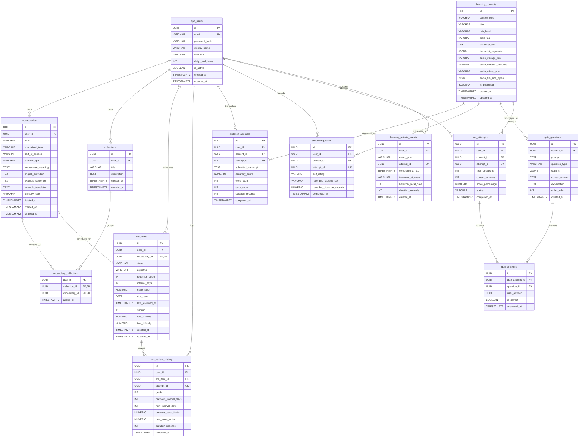

# EnglishFlow — Entity Relationship Diagram (ERD)

**Document Version**: 2.0.0  
**Milestone**: M0 — Discovery & Blueprint (Task M0-T07)  
**Author**: Principal Database Architect, Senior Spring Boot Engineer & API Designer  
**Reviewed By**: AI Technical Lead  
**Scope**: Target MVP Relational Persistence Model (Reconciled: 13 Tables)  
**Status**: Corrected Implementation Specification  

---

## 1. Visual Entity Relationship Diagram (Mermaid)



---

## 2. Reconciled 13-Table Mapping & Composite Foreign Keys

```
1.  app_users                  (Identity, credentials, timezone, daily goal)
2.  vocabularies               (Vocabulary terms, definitions, translations, soft-delete)
3.  collections                (Thematic decks, unique title per user)
4.  vocabulary_collections     (Composite FK join table: (collection_id, user_id) & (vocabulary_id, user_id))
5.  srs_items                  (Composite FK to vocabularies(id, user_id), SM-2 schedule, version)
6.  srs_review_history         (Composite FK to srs_items(id, user_id), attempt_id idempotency)
7.  learning_contents          (Curated exercise bank: dictation, shadowing, quizzes, audio metadata)
8.  dictation_attempts         (Transcriptions, accuracy scores, attempt_id idempotency)
9.  shadowing_takes            (Speech takes, self-ratings, optional audio keys, attempt_id idempotency)
10. quiz_questions             (Prompts, options JSONB, canonical answers)
11. quiz_attempts              (Quiz sessions, scorecards, attempt_id idempotency)
12. quiz_answers               (Individual question submissions)
13. learning_activity_events   (Append-only immutable event sink for heatmap & streaks)
```

---

## 3. Structural Domains & Database Ownership Guarantees

### 3.1 Composite Foreign Key Enforcement
To prevent cross-user entity linkage, the database enforces composite foreign keys across critical relationships:
* `vocabulary_collections`:
  * `(collection_id, user_id)` references `collections(id, user_id)`.
  * `(vocabulary_id, user_id)` references `vocabularies(id, user_id)`.
  * *Guarantee*: It is physically impossible at the SQL engine level to associate User A's vocabulary word with User B's collection.
* `srs_items`:
  * `(vocabulary_id, user_id)` references `vocabularies(id, user_id)`.
  * *Guarantee*: An SRS schedule can never point to a vocabulary word owned by another user.
* `srs_review_history`:
  * `(srs_item_id, user_id)` references `srs_items(id, user_id)`.
  * *Guarantee*: A review log entry cannot reference an SRS card owned by another user.

### 3.2 Non-Cascading Collection Deletion & Vocabulary Soft-Deletion
* When a collection is deleted, PostgreSQL cascading foreign keys remove only the `vocabulary_collections` join rows. The underlying `vocabularies` rows are never deleted.
* When a user removes a word from their active library, `vocabularies.deleted_at` is set. The word is excluded from active study lists, while historical logs in `srs_review_history` and `learning_activity_events` remain preserved.
